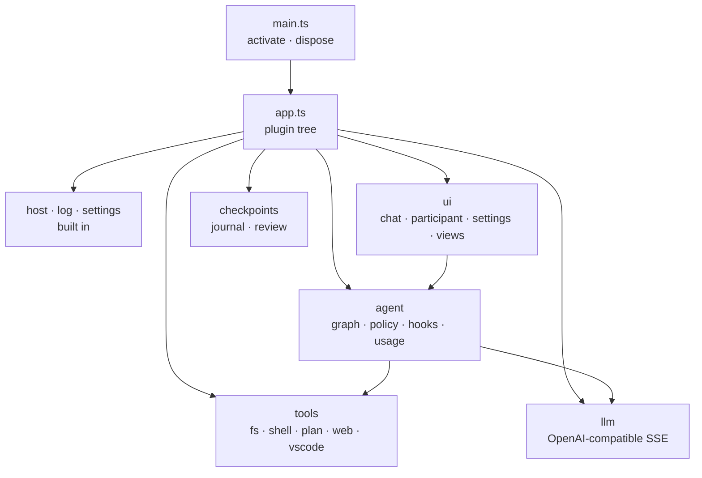

# Architecture and development

Comonad is one [Cordis](https://github.com/cordiverse/cordis) plugin tree. `src/app.ts` composes it;
`src/main.ts` creates the root context and mounts the app. Deactivation disposes the root fiber, and
every registration unwinds with its plugin.



## Key seams

- **Surfaces talk to the agent through typed events.** A surface calls
  `ctx.agent.runTurn({ surface })` and renders `agent/*` events for its own surface id.
  `approval/request` is a Cordis waterfall: each surface answers for its own turns, and the command
  palette provides the modal fallback.
- **Tools are plugin effects.** `ctx.tools.register(spec)` is attached to the calling plugin's
  lifetime. MCP mounts one child plugin per server.
- **One turn pipeline.** UI never assembles prompts; `ctx.agent` owns the graph loop, policy gate,
  hooks, usage and subagents, and mirrors everything to the audit log.
- **File writes go through `ctx.edit`** when the journal is loaded, which is how the journal sees
  every write without the agent knowing what a journal is.

## Source layout

```text
src/
  main.ts       activate/deactivate
  app.ts        the plugin tree
  host.ts       the VS Code Host contract
  lib/          pure domain: policy, trace, graph, sandbox, prompt, diff, references
  services/     Cordis services: agent, tools, decisions, llm, sessions, checkpoints, mcp, hooks, …
  llm/          OpenAI-compatible adapter
  tools/        tool plugins
  ui/           chat panel, participant, settings, views, commands
  plugins/      watchers that reload catalogs and MCP on config/trust changes
```

## Build and test

```sh
npm install
npm run watch        # typecheck + bundle in watch mode
npm run check-types
npm run lint
npm run compile-tests && npx mocha --ui tdd out/test/extension.test.js   # fast suite
npm test             # full VS Code test host
npm run package      # production bundle
```

esbuild bundles the extension into one CJS file; the test bundle is built the same way, so the fast
suite runs the real services on a headless Cordis context with a fake host (`src/test/harness.ts`).
Tests cover the policy gate, rule syntax, graph parse/compile/suspend, frontmatter, path guards,
diff parsing, session persistence, the journal, the content layer and the Cordis kernel itself.

## Plugin packages

Two packages ship beside the bundle as plugins:

- `packages/comonad-plugin-tavern` — the SillyTavern content layer.
- `packages/comonad-plugin-math` — KaTeX, its stylesheet and its fonts.

Each is built as its own bundle by `npm run build:plugins` (part of `npm run compile`). The tavern
plugin imports the host's shared vocabulary by name (`@comonad/*`) and ships as one folder.

## Documents

The docs site is VitePress. Run it locally:

```sh
cd docs
npm install
npm run dev
```

The site root is English; `/zh/` is Chinese. `docs/internal/` is excluded from the build.

## Contributing

See [CONTRIBUTING.md](https://github.com/zeroDtree/comonad-vscode-extension/blob/main/CONTRIBUTING.md)
for the development setup, test expectations and documentation style.

## Next

- [Reference: settings](/reference/settings)
- [Extending](/guide/extend)
- [GitHub repository](https://github.com/zeroDtree/comonad-vscode-extension)
