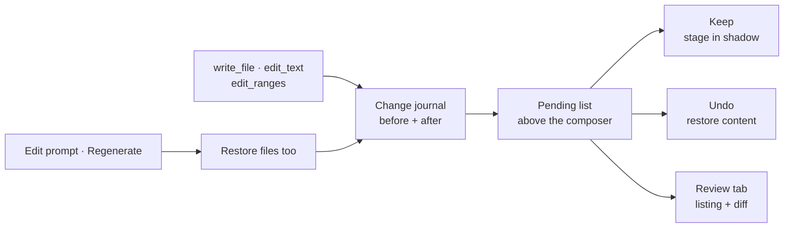

# Checkpoints and review

Comonad journals each file the agent writes, one entry per write, in a shadow store outside your
project. Your own `.git` is never touched. Nothing is snapshotted on every turn: a turn that writes no
file costs nothing, and the review only looks at the files the journal names.

## Pending changes

The list above the composer shows each file with `+N −M` counts. **Undo** and **Keep** act on all of
them; clicking a row opens the **File Review** tab: an ordinary, editable file tab with the deleted
lines drawn in place, complete and wrapping, and **Undo** / **Keep** under every block. Type in it
and press `Cmd/Ctrl+S` like any other file; the tab carries VS Code's own dirty dot and close prompt.
**Open in Editor** switches to VS Code's editor when you want its language services. Once everything is
reviewed, the list stays on screen as a **reviewed** list, newest decision first. A new pending
change switches it back to the pending files.

- **Keep** accepts a file or hunk.
- **Undo** restores the content from before the agent wrote it.
- **Review** opens the **Review Changes** tab: a file list with `+N −M` counts, the selected file's
  diff with three lines of context, and **Keep** / **Undo** on every block. The top bar acts
  on every file; the file header acts on the selected one. Click a line number to open the real file
  beside the review at that line.

The Review tab is derived from the journal, not from a second copy of the changes: closing and
reopening it shows the same pending state, and a block kept in the **File Review** tab disappears
from this tab immediately. It reviews saved content. A file with unsaved text disables its block and
file actions until you save; a file changed outside the agent disables block actions, and **Undo
File** asks before restoring it. **Keep All** refuses while any pending file is unsaved, and **Keep**
accepts the file as it is on disk, including an outside edit.

The **File Review** tab (`Comonad: Review Changed File`, or clicking a pending file) is the
single-file counterpart and a full file tab: it is backed by the real `TextDocument`, so editing,
undo/redo, save, the dirty dot and the close prompt are VS Code's own. Inserted lines are green;
deleted lines are restored in place as real red rows that wrap and scroll like the rest of the file,
with an **Undo** / **Keep** bar under each block. The deleted text is complete — VS Code's decoration
API cannot draw inline text that spans or wraps lines, which is why this tab exists. It speaks the
same journal as the other surfaces, so a decision made here shows up everywhere.

Editing is editing and saving is saving: a save whose bytes differ from the agent's last write marks
the file **Changed outside** (exactly as saving it in a normal editor would), so per-block actions
turn off until **Keep File** accepts the file as it now is or **Undo File** restores the baseline
after asking. Unsaved text disables the review actions everywhere, and file actions, until you save.
**Open in Editor** opens the same document in VS Code's editor beside the tab; edits made in either
view stay in sync.

A subagent's file-tool writes are journaled under the **parent chat**, not under a session of their
own. They appear in the same pending list, the same diff and the same restore points as the main
agent's writes. Parallel write tasks are allowed: each tracked write passes through one per-path
lock, so two children writing different files proceed together while writes to the same file are
serialised. A child's test shell gets its own scratch subtree, so parallel builds do not share a
journal or a build directory.

## Restoring a turn

Editing a prompt with the pencil and resending it offers **Restore files too** when the agent wrote
files at or after that turn. **Regenerate** asks the same question about the last turn. Both use the
same restore points and the same dirty-editor and outside-change checks as undo.

Because the fork and restore points are turn boundaries, a forked chat can never hold a tool call
without the result that answers it.

## Limits

- **Changes made by shell commands (`run_shell`) are not tracked.** Review those with git. A shell
  can change any file, and the journal only knows what the agent's own write tools wrote.
  `run_shell_test` is the exception in the other direction: it can write only its scratch directory,
  so it never changes a project file to begin with.
- Shadow stores from the earlier snapshot design are removed when the journal is mounted. Their
  sessions keep their transcripts, but cannot be restored to an earlier file state.

## Commands

| Command | Purpose |
| --- | --- |
| **Comonad: Review Changes** | Open the Review tab: keep/undo a block, a file, or everything |
| **Comonad: Review Changed File** | Open one pending file as an editable tab, deletions in place and a bar under every block |
| `Cmd+Alt+D` / `Ctrl+Alt+D` | The same review |
| `/review [focus]` | Ask the agent to review pending changes read-only |

The journal is a row of the shipped plugin tree. Turning off `checkpoints` removes the service, the
review commands and the keybinding together; writes then simply write, with no undo story.

## Next

- [Context](/guide/context) — compaction and restore points
- [Safety](/guide/safety) — what the agent may write
