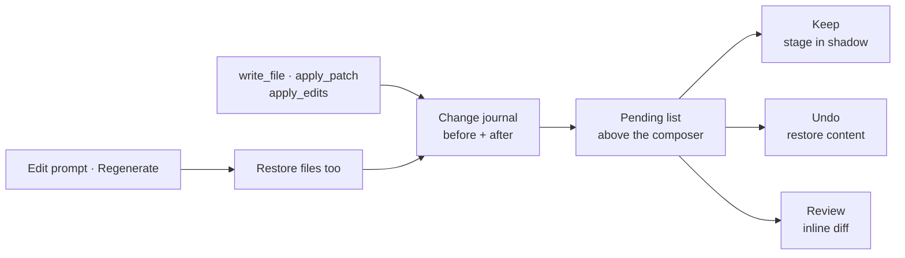

# Checkpoints and review

Comonad journals each file the agent writes, one entry per write, in a shadow store outside your
project. Your own `.git` is never touched. Nothing is snapshotted on every turn: a turn that writes no
file costs nothing, and the review only looks at the files the journal names.

## Pending changes

The list above the composer shows each file with `+N −M` counts. **Undo** and **Keep** act on all of
them; clicking a row opens the file in the normal editor with the inline review. Once everything is
reviewed, the list stays on screen as a **reviewed** list, newest decision first. A new pending
change switches it back to the pending files.

- **Keep** accepts a file or hunk.
- **Undo** restores the content from before the agent wrote it.
- **Review** opens the diff editor for file-level or hunk-level decisions.

A file you edited since the agent last wrote it, or one open with unsaved text, is never overwritten
silently: the review asks, or refuses until you save.

A subagent's file-tool writes are journaled under the **parent chat**, not under a session of their
own. They appear in the same pending list, the same diff and the same restore points as the main
agent's writes.

## Restoring a turn

Editing a prompt with the pencil and resending it offers **Restore files too** when the agent wrote
files at or after that turn. **Regenerate** asks the same question about the last turn. Both use the
same restore points and the same dirty-editor and outside-change checks as undo.

Because the fork and restore points are turn boundaries, a forked chat can never hold a tool call
without the result that answers it.

## Limits

- **Changes made by shell commands (`run_shell`) are not tracked.** Review those with git. A shell
  can change any file, and the journal only knows what the agent's own write tools wrote.
  `run_shell_test` is the exception in the other direction: it can write only its scratch directory,
  so it never changes a project file to begin with.
- Shadow stores from the earlier snapshot design are removed when the journal is mounted. Their
  sessions keep their transcripts, but cannot be restored to an earlier file state.

## Commands

| Command | Purpose |
| --- | --- |
| **Comonad: Review Pending Changes** | Open a diff, keep/undo a file or hunk, or keep/undo everything |
| `Cmd+Alt+D` / `Ctrl+Alt+D` | The same review |
| `/review [focus]` | Ask the agent to review pending changes read-only |

The journal is a row of the shipped plugin tree. Turning off `checkpoints` removes the service, the
review commands and the keybinding together; writes then simply write, with no undo story.

## Next

- [Context](/guide/context) — compaction and restore points
- [Safety](/guide/safety) — what the agent may write
