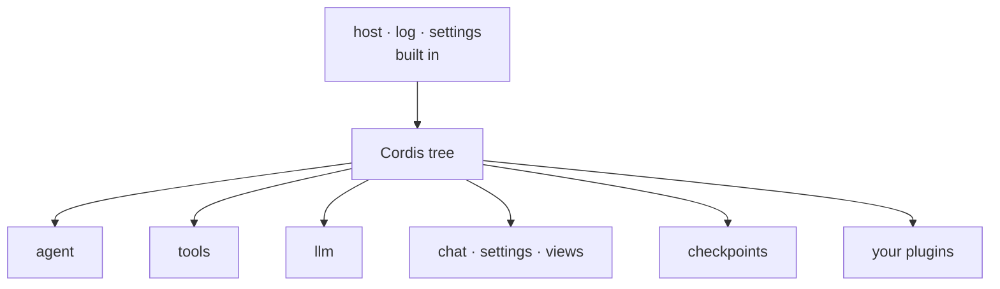

# Extending

Everything in Comonad is a plugin on one [Cordis](https://github.com/cordiverse/cordis) context:
the kernel, tools, model adapters, panels and the content layer. A plugin is a row in `cordis.yml`,
and anything it registers is an effect that disappears when the row is turned off.



## Rows

Project rows live in `.comonad/cordis.yml`; user rows in `~/.comonad/cordis.yml`.

```yaml
# .comonad/cordis.yml
- { id: comonad-plugin-tavern, name: ./plugins/comonad-plugin-tavern/dist/index.js }
- { id: mine, name: ./mine.js, config: { greeting: hello } }
- { id: scratch, name: ./scratch.js, disabled: true }
```

A `name` that is a path is read as a file: `./x` and `../x` relative to the `cordis.yml` that names
it, `~/x` from your home folder, `/abs/x` as it is. Any other name is a package.

## Write a plugin

```js
// mine.js — a policy and a tool, both effects of the plugin
export const name = 'mine'
export const inject = ['tools'] // declared, never inferred

export function apply(ctx, config) {
  ctx.on('tools/pre-execute', (exec, next) =>
    exec.name === 'run_shell' && /rm -rf/.test(String(exec.arguments?.command ?? ''))
      ? { kind: 'deny', reason: 'not that command' }
      : next(),
  )

  ctx.tools.register({
    name: 'hello',
    description: 'Say hello.',
    capability: 'ro',
    needsNetwork: false,
    needsWorkspace: false,
    parameters: { type: 'object', properties: {}, required: [], additionalProperties: false },
    execute: async () => config.greeting,
  })
}
```

- **Reading a service requires `inject`.** A row that injects something not loaded stays *pending* —
  that is how "this feature is off" is spelled. The host's own `ctx.plugins` is the exception; read it
  with `ctx.get('plugins')`.
- **Everything a plugin registers goes away with it.** Tools, commands, watchers and panels are
  disposed with the row.
- **A config is the plugin's own schema.** Export `Config` (a schemastery schema) and the row's
  config is validated before `apply`.
- **A broken row is reported, not fatal.** The rest of the tree loads anyway.

## Reference resolvers

A plugin can teach `@` a new file type without touching the composer, the message model or the wire:

```js
export const inject = ['references']

export function apply(ctx) {
  ctx.effect(() => ctx.references.register({
    id: 'my-format',
    priority: 10,
    mimes: ['application/x-my-format'],
    extensions: ['.myf'],
    claim: ({ head }) => head[0] === 0x25 && head[1] === 0x4d && head[2] === 0x59 && head[3] === 0x46, // "%MYF"
    resolve: async (input) => {
      const bytes = await input.readBytes(input.limits.maxDocumentBytes)
      return [{ kind: 'text', form: 'file', source: { path: input.displayPath }, text: parse(bytes) }]
    },
  }))
}
```

`ctx.references` owns path guards, sandbox read scope, deduplication, budgets and the stamp that puts a
part on the user message. A resolver only recognizes a format and returns typed parts; a part that
claims a file and then fails becomes an error note, not a UTF-8 fallback. `comonad-plugin-pdf` is the
worked example for a document resolver.

## Install and manage

**Settings → Plugins → Install…** offers the plugins that ship with Comonad by name, or a folder of
your own. An install copies the folder to `~/.comonad/plugins/<id>` and writes a row into your
`cordis.yml`. **Uninstall** removes the row and the installed folder after confirmation.

The panel lists every row in load order, where it came from, what it resolved to, and its state
(`loaded`, `off`, or `not loaded` with the reason). **Disable** / **Enable** writes the change into the
workspace list when trusted, otherwise the user list, and reapplies only that row.

**Settings → Inspect → Plugins** shows the dependency tree: what each plugin provides, what it needs,
who provides it, and what goes down with it when turned off.

## DeepSeek Harness plugins

The `harness` row redirects `@deepseek-ai/*` imports, so a plugin written for
[DeepSeek Harness](https://github.com/deepseek-ai/deepseek-harness) loads as it is:

```json
{ "id": "permission-gate", "name": "./permission-gate.mjs" }
```

```ts
import type { Context } from '@deepseek-ai/cordis'

export const name = 'permission-gate'
export const inject = ['tools']

export function apply(ctx: Context) {
  ctx.on('tools/pre-execute', (exec, next) => {
    if (String(exec.arguments?.command ?? '').includes('rm -rf')) {
      return { kind: 'deny', reason: 'Denied by policy.' }
    }
    return next()
  })
}
```

Comonad implements the tool and policy half of the harness: `ctx.tools.register()` accepts both spec
shapes, `@deepseek-ai/cordis` is the same context class, and the four waterfalls — `tools/pre-execute`,
`tools/execute`, `tools/post-execute`, `tools/result` — use the harness payloads and decisions. The
harness's agent and session internals are not implemented; a missing name resolves to an empty module
and says so in the log.

## Hooks

Hooks run at lifecycle points: `SessionStart`, `UserPromptSubmit`, `PreToolUse`, `PostToolUse`,
`PostToolUseFailure`, `Stop`. Handlers can be a command, HTTP, an MCP tool or a prompt. A handler can
return a permission decision (`deny` / `ask` / `allow`), additional context, or updated input.

```json
{
  "PreToolUse": [
    {
      "matcher": "run_shell",
      "hooks": [
        {
          "type": "command",
          "if": "run_shell(rm:*)",
          "command": "echo '{\"hookSpecificOutput\":{\"permissionDecision\":\"deny\",\"permissionDecisionReason\":\"no rm\"}}'"
        }
      ]
    }
  ]
}
```

Project hooks live in `.comonad/hooks.json`; user hooks in `globalStorage/hooks.json`. They load only
in trusted workspaces, and exit code 2 blocks.

## Other extension points

| Mechanism | Location | Notes |
| --- | --- | --- |
| Instructions | `COMONAD.md`, `AGENTS.md`, `.comonad/instructions.md` | Hierarchical; trusted workspaces only |
| Rules | `.comonad/rules/*.md` | Loaded into the system prompt |
| Skills | `.comonad/skills/<name>/SKILL.md` | Listed in the prompt, loaded on demand |
| Subagents | `.comonad/agents/*.md` + `comonad.subagents` | Frontmatter selects the tools; settings grant the writes |
| Commands | `.comonad/commands/*.md` | Custom slash commands |
| MCP | `comonad.mcpServers` | stdio or streamable HTTP; per-server capability and overrides |
| Memory | Agent-owned `MEMORY.md` | Loaded into the prompt, edited with the `memory` tool |

### Subagents

A subagent is a Markdown file under `.comonad/agents/` or `~/.comonad/agents/`:

```markdown
---
name: writer
description: Implement a focused change.
tools: [read_file, grep_files, write_file, apply_patch, run_shell_test]
maxTurns: 20
---
Implement the change. Use the file tools for every project write; run_shell_test writes only its
scratch directory.
```

The frontmatter **selects** tools. Writes also need a **grant** in `comonad.subagents` (Settings →
Subagents):

```json
{ "comonad.subagents": { "writer": { "files": true, "test": true } } }
```

Read-only tools need no grant. `files` enables only tracked file tools (`write_file`, `apply_patch`,
`apply_edits`); `test` enables `run_shell_test`. `run_shell`, `start_shell` and plan writes are never
granted to a subagent. A definition without a `tools` list is read-only. The parent mode must allow
the capability too. See [Safety](/guide/safety#subagents).

`maxTurns` (default 20) bounds the child's graph budget at two steps per turn, with a minimum of
four steps. It can tighten `comonad.subagentStepsMode`/`comonad.subagentSteps` but never loosen
them; see [Settings](/reference/settings#subagents).

### MCP

MCP servers are configured in `comonad.mcpServers`:

```json
{
  "comonad.mcpServers": {
    "filesystem": {
      "command": "npx",
      "args": ["-y", "@modelcontextprotocol/server-filesystem", "/workspace"],
      "capability": "ro"
    }
  }
}
```

Each server can set `capability`, `writeTools`, `exclude` and per-tool `overrides`. Tools appear as
`server__tool` and pass through the same policy gate as built-ins. A server is a child plugin: turning
it off closes the connection and removes its tools.

## Next

- [Reference: tools](/reference/tools) — the built-in catalog
- [Architecture](/development) — the kernel seams and test host
- [Safety](/guide/safety) — how plugin tools are gated
