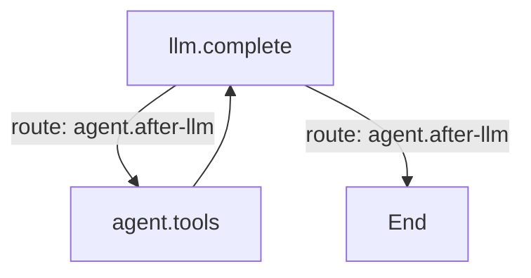

# Graphs

The inner loop of a turn is a compiled Mermaid graph: the model call, the tool step and the routes
between them. **Settings → Graph** is the Graph plugin's pane. A source may hold several named graphs:

`%% graph: id` names a graph, `%% default: id` picks the turn's own loop, and
`%% soft node: instruct` lets the model choose a target. Only the default graph runs a turn; the other
named graphs remain available to plugins through `ctx.graphs.get(id)`.

## Editing

The pane edits one graph at a time:

- The picker holds **Set default**, **Duplicate**, **Delete** and **+ New**.
- **Whole source** edits every graph in one buffer instead of the selected one.
- **Validate** checks the source before **Save** writes `comonad.graph`; **Use shipped default**
  clears the setting back to the shipped `agent` loop.
- The preview renders the selected graph live, and lists the node implementations and routes plugins
  registered. **Max steps** in the Agent tab caps the whole turn (`0` means no limit).

## Plugins

Graph is a row in the shipped `cordis.yml`. Turning **graph** off leaves the agent with no engine,
which the Plugins tab shows as a dependency.
