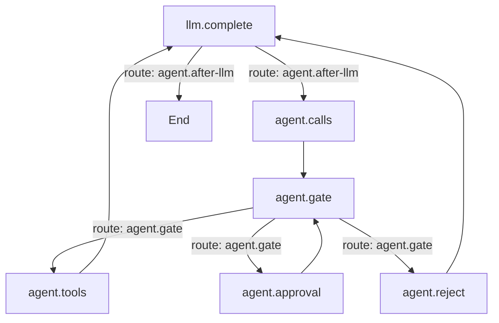

# Graphs

The inner loop of a turn is a compiled Mermaid graph: the model call, the policy gate, the approval
suspension, the tool step and the routes between them. **Settings → Graph** is the Graph plugin's
pane. A source may hold several named graphs:

`%% graph: id` names a graph, `%% default: id` picks the turn's own loop, and
`%% soft node: instruct` lets the model choose a target. Only the default graph runs a turn; the other
named graphs remain available to plugins through `ctx.graphs.get(id)`.

## Graph, policy and executor

- The **graph** drives the turn. `agent.calls` starts one tool batch, `agent.gate` maps the policy
  outcome onto a route, and `End` is reachable only from the model node, so a turn always ends on a
  model round.
- The **policy** is a pure decision: it returns `allow`, `confirm` or `reject` for a batch and a trace
  for every call, and knows nothing about nodes or routes.
- The **executor** (`agent.tools` and `ctx.tools.invoke`) verifies the gate's single-use
  `ToolAuthorization` before any tool body runs. `agent.tools` has exactly one predecessor,
  `agent.gate`; a custom graph that wires around the gate reaches the executor without a grant and
  the call is refused.
- `agent.approval` suspends the run and returns to `agent.gate`, which re-evaluates the batch: a
  policy rejection or a user denial wins, while an approval turns `confirm` into `allow`.

## Editing

The pane edits one graph at a time:

- The picker holds **Set default**, **Duplicate**, **Delete** and **+ New**.
- **Whole source** edits every graph in one buffer instead of the selected one.
- **Validate** checks the source before **Save** writes `comonad.graph`; **Use shipped default**
  clears the setting back to the shipped `agent` loop.
- The preview renders the selected graph live, and lists the node implementations and routes plugins
  registered. **Max steps** in the Agent tab caps the whole turn (`0` means no limit).

## Plugins

Graph is a row in the shipped `cordis.yml`. Turning **graph** off leaves the agent with no engine,
which the Plugins tab shows as a dependency.
