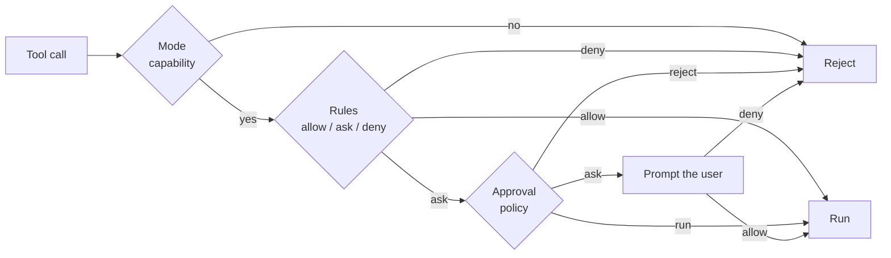

# Safety

Three layers decide whether a tool call runs, in order. A denial always wins.



## 1. Mode

The mode decides which capabilities exist at all.

| Mode | Capabilities |
| --- | --- |
| Chat Only (`chat`) | No tools; plain conversation |
| Read-Only (`ro`) | Read files, read-only shell |
| Semi-Write (`sw`) | + write files, + test shell (workspace read-only, scratch writable) |
| Full Access (`aw`) | + full shell inside the workspace |
| Plan (`pl`) | Read files, read-only shell, writes plan files only |

The mode is remembered per chat; new chats start from `comonad.mode`.

## 2. Rules

Rules are patterns in `comonad.permissions.allow`, `ask` and `deny`:

```text
run_shell(npm run test:*)
read_file(./.env)
fetch_url(domain:example.com)
```

Edit them in **Comonad: Open Settings → Rules**, one rule per line. A deny rule always wins; an allow
rule always runs without asking. Without a matching rule, the approval policy decides.

## 3. Approval policy

| Policy | Behaviour |
| --- | --- |
| `manual` | Ask for every call |
| `whitelist_accept` | Run the read-only defaults and allowed rules; ask for the rest |
| `blacklist_reject` | Reject the write-capable defaults and denied rules; run the rest |
| `universal_accept` | Run everything the mode allows |
| `universal_reject` | Run nothing |

Approvals pause the turn. **Always allow** adds an allow rule. **Stop** cancels the turn for real:
a foreground shell command is killed with its process tree, and a pending approval is withdrawn and
denied. Background tasks started with `start_shell` keep running; stop them from the Tasks view or
with `stop_shell`.

## Sandbox

Shell commands run under:

- **macOS:** `sandbox-exec`
- **Linux:** `bwrap`
- **No OS sandbox:** Windows, or a host without the tool — every shell call asks for confirmation,
  even under an accept policy

`comonad.allowUnsandboxedShell` opts out of that extra prompt. Tools named `*_unsandboxed` always ask.

### Workspace boundary

- `comonad.confineWrite` (on by default) keeps writes inside the working directory.
- `comonad.confineRead` (off by default) does the same for reads.
- Both apply to file tools and the shell sandbox; symlinks are resolved before the check.
- A write-confined full shell gets a scratch directory at `<working directory>/.comonad/tmp` with
  `TMPDIR` pointing at it.
- The test shell uses a separate, private tree in the extension's storage instead; see below.
- `.env` files are denied to reading and writing; `.git` is never writable by file tools.
- Secrets (keys, tokens, passwords) are stripped from the environment unless
  `comonad.filterSensitiveEnv` is off.

With network off, loopback TCP/UDP stays available inside the sandbox, so local test servers work;
only traffic that leaves the machine is blocked.

### The test shell

`run_shell_test` (capability `shell_test`, available in `sw` and `aw`) keeps the workspace
read-only and opens only a private scratch tree:

- **macOS:** `sandbox-exec` denies every write, then allows the scratch path.
- **Linux:** `bwrap` mounts the workspace read-only, the scratch read-write, and gives the command a
  private `/tmp` of its own (never the host's).
- `TMPDIR`, `TMP`, `TEMP`, `HOME`, `XDG_CACHE_HOME`, `PYTHONPYCACHEPREFIX` and `COMONAD_SCRATCH`
  point into that tree, so test runners and build tools write there instead of the repository.
- Without an OS sandbox the tool is refused outright. `comonad.allowUnsandboxedShell` and allow
  rules do not override this: the capability's promise cannot be kept without one.

## Subagents

A subagent's effective tools are the intersection of four things:

1. the parent mode's capabilities;
2. the per-agent grant in `comonad.subagents` (**Settings → Subagents**);
3. the agent definition's `tools` list;
4. the hard subagent cap.

The hard cap means a subagent **never** gets `shell_rw` or `rw_plan`:

- `files` grants only tracked file tools (`write_file`, `apply_patch`, `apply_edits`).
- `test` grants `run_shell_test`.
- Read-only tools are always available.
- A definition with no `tools` list is read-only.
- Built-in `implement` defaults to **files + test**; every other built-in and every custom agent
  defaults to read-only until granted.
- A project file that shadows a built-in name does not inherit that built-in's default grant.
- A subagent's file writes are journaled under the **parent chat**, so they appear in its review,
  inline diff and Git Changes.
- Write-capable subagents run in the foreground, one at a time. A background subagent is read-only.
- An `ask` rule is escalated, and a subagent cannot answer it, so the call is refused rather than
  auto-approved.
- Under `manual`, approving the `agent` call is the approval for that subagent's listed tools. Use
  `deny` (or `ask`) rules to stop a specific call inside a subagent.

## Command timeout

Foreground shell calls take an optional model-chosen `timeout` in seconds, clamped to 1–300.
`comonad.commandTimeout` is the fallback, and **Always use the command timeout**
(`comonad.commandTimeoutOverride`) replaces the model's choice with that fixed value. `start_shell`
tasks have no timeout.

## Dangerous commands

Commands shaped like `rm -rf`, `sudo`, `curl | sh`, `git push --force` and similar always prompt,
even under accept policies. The one exception is cleanup of the agent's own work: a non-recursive
`rm` whose every target is either inside the workspace and recorded as created by this session, or
inside the test shell's private scratch tree. A `*`/`?` glob and the variables the test shell sets
(`$TMPDIR`, `$HOME`, `$COMONAD_SCRATCH`, …) are expanded first and every match is checked. Recursive
deletes, unknown variables, substitutions, symlinked parents that resolve outside the allowed
trees, a glob that matches nothing, and anything else the scanner cannot prove still prompt.

## Presets

The three layers can be combined into presets: **Ask**, **Plan**, **Auto**, **Read only** and
**Full access**. **Comonad: Select Model** uses the model menu; presets live in the mode and approval
controls. `comonad.allowFullAccess: false` hides the unrestricted preset, and **Full access** is the
one preset that drops the workspace boundary.

## Workspace Trust

Project plugins, hooks and instruction files are not loaded in untrusted workspaces. Tool calls still
follow the configured approval policy and OS sandbox.

## Next

- [Checkpoints and review](/guide/checkpoints) — what happens to files the agent writes
- [Settings](/reference/settings) — every safety-related setting
- [Architecture](/development) — the policy gate and event seams
