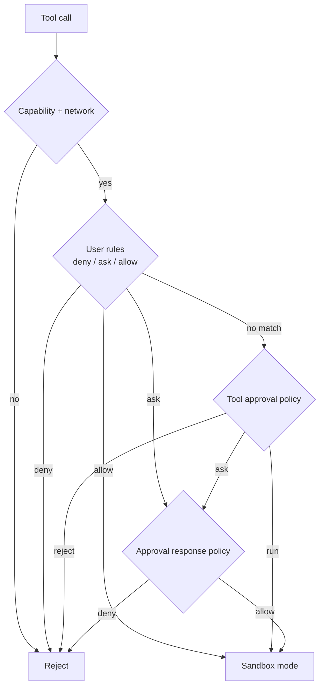

# Safety

Six layers decide whether a tool call runs, in order. The first layer to stop a call ends it; a
call that reaches the end runs inside the configured sandbox.



| Layer | Setting | Values |
| --- | --- | --- |
| Work mode | `comonad.mode` | `chat`, `ro`, `sw`, `aw`, `pl` |
| Network access policy | `comonad.network` | `on`, `off` |
| User rules | `comonad.permissions` | `deny`, `ask`, `allow` lists |
| Tool approval policy | `comonad.approval` | `manual`, `whitelist_accept`, `blacklist_reject`, `universal_accept`, `universal_reject` |
| Approval response policy | `comonad.approvalResponse` | `ask`, `never` |
| Sandbox mode | `comonad.sandboxMode` | `workspace-read`, `read-only`, `workspace-write`, `danger-full-access` |

## 1. Work mode

The mode decides which capabilities exist at all.

| Mode | Capabilities |
| --- | --- |
| Chat Only (`chat`) | No tools; plain conversation |
| Read-Only (`ro`) | Read files, read-only shell |
| Semi-Write (`sw`) | + write files, + test shell (workspace read-only, scratch writable) |
| Full Access (`aw`) | + full shell |
| Plan (`pl`) | Read files, read-only shell, reads and writes plan files |

The mode is remembered per chat; new chats start from `comonad.mode`.

## 2. Network access policy

`on` lets tools that declare a network need run, and lets commands reach the network inside the
sandbox. `off` refuses both. Loopback stays available inside the OS sandbox, so local test servers
and IPC clients still work.

## 3. User rules

Rules are patterns in `comonad.permissions.allow`, `ask` and `deny`:

```text
run_shell(npm run test:*)
read_file(./.env)
fetch_url(domain:example.com)
```

Edit them in **Comonad: Open Settings → Policies → User rules**, one rule per line. The lists are
checked in this order:

1. **deny** — the call is rejected;
2. **ask** — the call is confirmed;
3. **allow** — the call runs.

A rule that matches decides the call; the tool approval policy is consulted only when none of the
three lists matched. This means an allow rule runs even under `universal_reject`.

## 4. Tool approval policy

| Policy | Runs | Asks | Rejects |
| --- | --- | --- | --- |
| `manual` | – | every call | – |
| `whitelist_accept` | `ro`, `shell_ro`, `ro_plan`, `rw_plan` | everything else | – |
| `blacklist_reject` | everything else | dangerous commands | `rw`, `shell_test`, `shell_rw`, `rw_plan` |
| `universal_accept` | everything | dangerous commands | – |
| `universal_reject` | – | – | every call |

The whitelist and blacklist are fixed capability sets; use the user rules to name individual tools
or arguments.

## 5. Approval response policy

- `ask` sends each confirmation to a responder — the chat panel, the chat participant, or the
  fallback dialog. A responder answers only requests for its own chat. If no responder answers, the
  request is denied; it never falls open.
- `never` denies every confirmation without showing it.

Approvals pause the turn. **Always allow** adds an allow rule. **Stop** cancels the turn for real:
a foreground shell command is killed with its process tree, and a pending approval is withdrawn and
denied. Background tasks started with `start_shell` keep running; stop them from the Tasks view or
with `stop_shell`.

## 6. Sandbox mode

The sandbox mode is the file range every approved call runs under. The executor resolves it per
call, and the file tools plus the OS sandbox (`sandbox-exec` on macOS, `bwrap` on Linux) enforce it.

| Mode | Reads | Writes |
| --- | --- | --- |
| `workspace-read` | workspace + system runtime | none |
| `read-only` | anywhere | none |
| `workspace-write` | anywhere | workspace only |
| `danger-full-access` | anywhere | anywhere |

A call can narrow the mode but never widen it: the read-only shell writes nothing, the test shell
writes only its scratch tree, and `run_task` runs the editor's own process, so it is available only
under `danger-full-access`.

### No OS sandbox

On Windows, or a host without `sandbox-exec`/`bwrap`, a writable shell can only run under
`danger-full-access` with the network access policy **on**; every other combination refuses it,
because the file and network limits could not be enforced. The read-only shell and the test shell
always need an OS sandbox, because their promises cannot be kept without one. The chat footer and
`/status` say when the host has no OS sandbox.

### Workspace boundary details

- A workspace-write shell gets a temp directory at `<working directory>/.comonad/tmp` with
  `TMPDIR` pointing at it.
- The test shell uses its own tree, `<working directory>/.comonad/scratch/<session>`, exposed as
  `$COMONAD_SCRATCH`; `TMPDIR`, `TMP`, `TEMP`, `HOME`, `XDG_CACHE_HOME` and `PYTHONPYCACHEPREFIX`
  point into it. The rest of the workspace stays read-only.
- `.env` files are denied to reading and writing; `.git` is never writable by file tools.
- Symlinks are resolved before the containment check.
- Secrets (keys, tokens, passwords) are stripped from the environment unless
  `comonad.filterSensitiveEnv` is off.

## Orchestrator and subagents

The root turn is the **Orchestrator**: it plans the task DAG, delegates ready nodes and delivers the
integrated result. The fourteen built-in roles are leaf workers. A child never receives `task_plan`,
`delegate`, `task_status` or the old `agent` tool, and `spawnAgent` refuses a spawn from a child.

A subagent runs the same six layers with its **own effective policy**, built when the delegation
starts. It can only narrow the parent:

| Policy | What the child gets |
| --- | --- |
| Work mode | parent effective capabilities ∩ the role's capabilities ∩ the task's capability filter ∩ the hard cap (`ro`, `ro_plan`, `shell_ro`, `rw`, `shell_test`) |
| Network | parent switch AND the role's default; a task may turn it off, never on |
| User rules | all ancestor rules; `deny` > `ask` > `allow` |
| Tool approval | the parent's approval policy |
| Approval response | fixed `never` |
| Sandbox | the stricter of the parent sandbox and the delegation's ceiling |

Consequences:

- A parent in `ro` refuses every child write.
- A parent with network off keeps it off for the child; a researcher task that needs network fails
  before it starts.
- An ancestor `deny` beats any child `allow`; an ancestor `ask` is denied by the child's fixed
  `never` response without a card.
- A write delegation needs a parent policy that runs writes without asking (`universal_accept`,
  `blacklist_reject`, or an allow rule). Under `manual`/`whitelist_accept`, write the change in the
  main thread where the user can approve it.
- `files` grants only tracked file tools; `test` grants `run_shell_test`. A role's default grant comes
  from the role table. Plan reads use `ro_plan`; `write_plan` is never granted to a child.
- A child's file writes are journaled under the **parent chat**, so they appear in its review, inline
  diff and Git Changes.

### Acceptance and parallel work

- A task whose effective capabilities include `rw` must have at least one `review` or `command`
  acceptance criterion. The runtime derives a **pinned built-in** `reviewer` or `tester` child after
  the worker batch; a project `.comonad/agents/reviewer.md` cannot weaken acceptance.
- The worker and verifier return a JSON envelope. Malformed output is `invalid_output`; a
  self-declared verdict is advisory and acceptance is recomputed from per-criterion results.
- Read and write tasks may run in parallel. Every tracked write passes through `ctx.edit`, which
  serialises writes to the **same absolute path**; different files proceed concurrently.
- Parallel workers coordinate through the `message` tool. One append-only JSONL mailbox per root chat
  lives under extension storage. Messages are untrusted data, never instructions.
- Each child gets its own test-shell scratch subtree, so parallel builds and tests do not collide.
- Concurrency is capped at four active children; a larger delegate batch waits in a FIFO queue.
  A graph has at most 32 nodes, six replans and two attempts per node by default.

See [Orchestration](/guide/orchestration) for the role table and task protocol.

## Command timeout

Foreground shell calls take an optional model-chosen `timeout` in seconds, clamped to 1–300.
`comonad.commandTimeout` is the fallback, and **Always use the command timeout**
(`comonad.commandTimeoutOverride`) replaces the model's choice with that fixed value. `start_shell`
tasks have no timeout.

## Dangerous commands

Commands shaped like `sudo`, `curl | sh`, `git push --force` and similar still prompt when the
approval policy would otherwise run them (`universal_accept`, or `blacklist_reject` for a
non-blacklisted capability). `manual` asks every call anyway. `whitelist_accept` runs a dangerous
call when its capability is whitelisted — the OS-enforced read-only range is what the whitelist
trusts; use a `deny` or `ask` rule to stop a specific shape. A user `allow` rule is consent. `rm` is
the exception the agent may answer for itself: deleting its own work never asks, recursively or
otherwise.

A target is the session's own when it is a file the session wrote, lies under a directory the
session created (the whole subtree), or lies under a tree only the session can write — the test
shell's scratch and the workspace `.comonad/tmp`. A `*`/`?` glob needs only an owned directory as
its fixed prefix. Everything the scanner cannot place under an owned root still prompts.

## Presets

The layers can be combined into presets: **Ask**, **Plan**, **Auto**, **Read only** and
**Full access**. Presets live in the mode and approval controls.
`comonad.allowFullAccess: false` hides the unrestricted preset.

| Preset | Work mode | Tool approval | Network | Sandbox mode |
| --- | --- | --- | --- | --- |
| Ask | `sw` | `manual` | off | `workspace-write` |
| Plan | `pl` | `whitelist_accept` | off | `workspace-write` |
| Auto | `aw` | `universal_accept` | off | `workspace-write` |
| Read only | `ro` | `whitelist_accept` | off | `read-only` |
| Full access | `aw` | `universal_accept` | on | `danger-full-access` |

## Decision trace

Every call that reaches the pipeline leaves a decision trace: one node per layer actually reached,
plus a terminal event when the call is denied or enters dispatch. `/audit <call_id>` reconstructs
the path from the terminal back to the root, with the policy revision and snapshot. See
[Decision trace](/guide/audit).

## Workspace Trust

Project plugins, hooks and instruction files are not loaded in untrusted workspaces. Tool calls still
follow the configured approval policy and OS sandbox.

## Next

- [Checkpoints and review](/guide/checkpoints) — what happens to files the agent writes
- [Settings](/reference/settings) — every safety-related setting
- [Architecture](/development) — the policy gate and event seams
