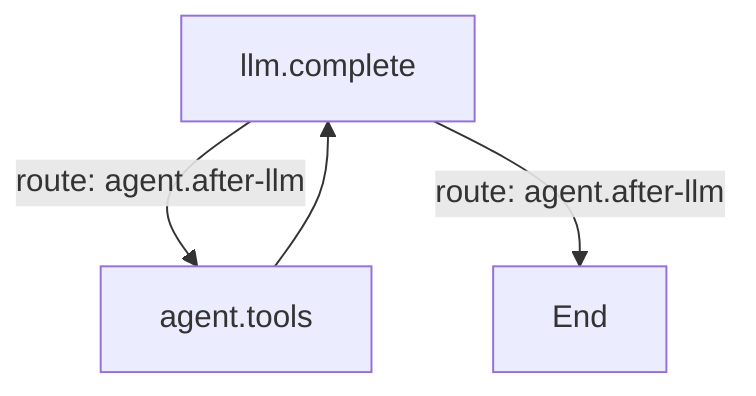

# Workflows

A workflow is the outer shape of a task: a sequence of stages, each with its own objective, tools,
approval gate and completion evidence. The inner loop is still a graph of model and tool calls; the
workflow decides what the next stage is, when the user must approve, and what counts as verified.

Comonad ships one best-practice workflow, **Standard coding task**:

| Stage | What runs | What it produces |
| --- | --- | --- |
| **Research** | An agent stage in read-only mode | Notes about the files, call paths, tests and constraints |
| **Plan** | An agent stage in plan mode | A concrete plan; the run pauses for approval |
| **Implement** | An agent stage in the session's mode | Focused edits, tracked in the change journal |
| **Verify** | A checks stage, no model call | Editor errors and the commands you configured |
| **Review** | An agent stage in read-only mode | The final report: changes, verification, remaining issues |

The plan gate is a real pause. **Approve** continues to implementation; **Deny** stops the workflow
and keeps the plan in the chat. The gate survives a window reload: `/resume` asks again.

## When it runs

Automatic runs are on by default for coding tasks in a write-capable mode (`sw` or `aw`). Pure
questions, `/plan`, `/review`, subagents and silent generations stay direct. Use `/workflow <task>`
to force the default workflow for one turn, or `/workflow <id> <task>` to pick another. A workflow
whose **When** is `Manual` never runs automatically.

The trigger, the default workflow and the whole library are in **Settings → Workflow**.

## Verification is evidence, not a claim

The checks stage never calls the model. It reports:

- **Editor diagnostics** that are new since the run started, in files this turn wrote. Errors that
  already existed are not counted.
- **Commands** you configured, run in order under the session's sandbox, network policy, deny-read
  paths and timeout. Commands come from workspace settings, so they run only in a trusted workspace.

A failure with repair budget left sends the run back to the repair stage (the shipped preset goes
back to **Implement**) with the check output. The model must fix it, and the checks run again. When
the budget is spent the workflow is marked **Failed**; the review stage is told to say so.

## Customize

**Settings → Workflow** is a visual editor:

- The library rail holds named workflows; duplicate the shipped preset to make a variant.
- A stage is either **Agent** (a named graph, a mode, an objective, an optional approval gate) or
  **Checks** (diagnostics, commands, timeout, repairs and the stage a failure returns to).
- Drag stages to reorder; add, duplicate and remove them.
- **Detect from package.json** suggests `npm test`, `npm run typecheck`, `npm run lint` and
  `npm run build` when those scripts exist.
- **JSON** shows the whole library for batch edits.

A stage's mode can only narrow the session's capabilities. A plan stage adds plan-file writes; it
never adds project writes. Read-only stages auto-approve read-only tool calls so research does not
ask for every file; project writes always use the session's approval policy.

## Graphs

**Settings → Graph** is the Graph plugin's pane. A source may hold several named graphs:

`%% graph: id` names a graph, `%% default: id` picks the turn's own loop, and `%% soft node:
instruct` lets the model choose a target. The pane edits one graph at a time, renders it live, and
lists the node implementations and routes plugins registered. Every agent stage in a workflow picks
one of these graphs by id.

## Plugins

Graph and Workflow are separate rows in the shipped `cordis.yml`. Turning **workflow** off removes
the Workflow tab and `/workflow`; normal turns still run the graph loop. Turning **graph** off leaves
the agent with no engine, which the Plugins tab shows as a dependency.
