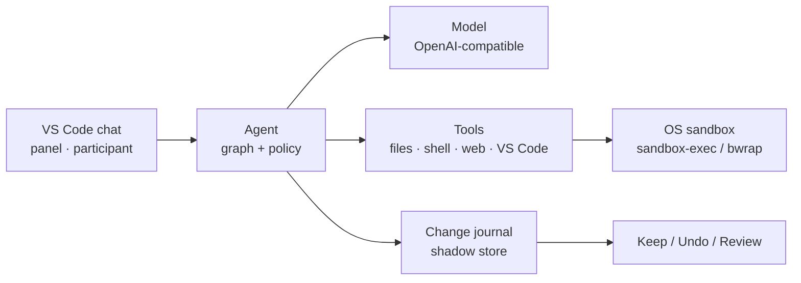

# Comonad Agent for VS Code

A local-first, auditable coding agent inside VS Code. It runs a graph-orchestrated tool loop
against the model you choose — DeepSeek by default, or any OpenAI-compatible endpoint — journals
every file it writes, and asks before anything leaves the sandbox.



## Why Comonad

- **Local-first.** API keys live in VS Code `SecretStorage`; sessions, checkpoints and logs stay on
  the machine (or the remote host) that runs the agent.
- **Auditable by construction.** Every turn is a graph run with typed events, a capability gate and
  an audit log. File writes are journaled per file, so nothing is silently overwritten.
- **Extensible as a plugin tree.** The kernel, tools, model adapters and UI are plugins on one
  [Cordis](https://github.com/cordiverse/cordis) context. Turn a row off, configure it, or mount
  your own.

## Install

**From a packaged VSIX**

```sh
npm run package
code --install-extension comonad-0.2.0.vsix
```

**From source**

```sh
npm install
npm run compile
```

Press `F5` in VS Code to launch the Extension Development Host.

Then set a model key — `DEEPSEEK_API_KEY` is enough for the default DeepSeek Flash profile — or add
any OpenAI-compatible endpoint with **Comonad: Configure Model Provider**. Open the chat with
**Comonad: Open Chat** (`Cmd+Alt+C` / `Ctrl+Alt+C`).

## First five minutes

1. Open the chat from the Secondary Side Bar.
2. Ask a question, or describe a change.
3. Approval prompts run inline: **Allow once**, **Always allow**, or **Deny**.
4. Shell and file changes are shown as tool cards; click a card to open the command and output.
5. Review pending files above the composer with **Keep**, **Undo**, or **Review**.

## Documentation

| Start | What it covers |
| --- | --- |
| [Chat](/guide/chat) | Sessions, composer, transcript, tool cards, `@` references |
| [Safety](/guide/safety) | Modes, approval policies, rules, sandboxing, secrets |
| [Context](/guide/context) | Window budget, compaction, `/context` |
| [Checkpoints and review](/guide/checkpoints) | Journal, Keep/Undo, restore points |
| [Content layer](/guide/content) | Characters, world books, personas, presets (SillyTavern formats) |
| [Extending](/guide/extend) | Plugins, hooks, skills, subagents, MCP |
| [Remote and containers](/guide/remote) | Remote SSH, WSL and Dev Containers |
| [Commands](/reference/commands) | Built-in and custom slash commands |
| [Tools](/reference/tools) | The tool catalog and MCP |
| [Settings](/reference/settings) | The settings you are likely to change |
| [Architecture and development](/development) | Kernel seams, build and tests |

Also available in [中文](/zh/).

## License

Comonad Agent for VS Code is licensed under **AGPL-3.0-only**. See
[LICENSE](https://github.com/zeroDtree/comonad-vscode-extension/blob/main/LICENSE). Third-party
components are listed in
[THIRD_PARTY_NOTICES.md](https://github.com/zeroDtree/comonad-vscode-extension/blob/main/THIRD_PARTY_NOTICES.md).
