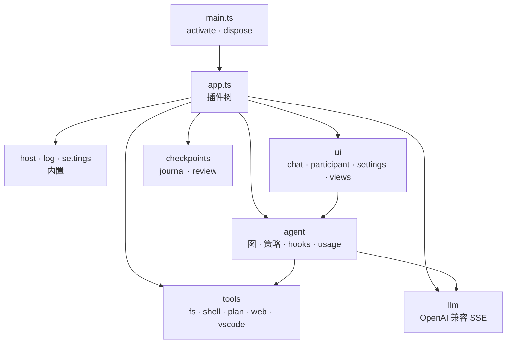

# 架构与开发

Comonad 是一棵 [Cordis](https://github.com/cordiverse/cordis) 插件树。`src/app.ts` 负责组装，
`src/main.ts` 创建根上下文并挂载应用。停用时会 dispose 根 fiber，所有注册随所属插件撤销。



## 关键接缝

- **Surface 通过类型化事件与 agent 通信。** surface 调用 `ctx.agent.runTurn({ surface })`，并渲染属于
  自己 surface id 的 `agent/*` 事件。`approval/request` 是 Cordis waterfall：每个 surface 回答自己的
  回合，命令面板提供模态回退。
- **工具是插件 effect。** `ctx.tools.register(spec)` 附着在调用插件的生命周期上。MCP 为每个服务器挂载
  一个子插件。
- **单一回合管线。** UI 从不组装提示词；`ctx.agent` 拥有图循环、策略门控、hooks、usage 和子代理，并把
  一切镜像到审计日志。
- **文件写入经 `ctx.edit`。** 日志行加载时，写入会经过它，所以日志能看到每次写入，而 agent 不需要知道
  日志的存在。

## 源码布局

```text
src/
  main.ts       activate/deactivate
  app.ts        插件树
  host.ts       VS Code Host 契约
  lib/          纯领域：policy、subagent、trace、graph、sandbox、prompt、diff、references
  services/     Cordis 服务：agent、tools、decisions、llm、sessions、checkpoints、mcp、hooks…
  llm/          OpenAI 兼容适配器
  tools/        工具插件
  ui/           聊天面板、participant、设置、视图、命令
  plugins/      配置/信任变化时重载目录与 MCP 的 watcher
```

## 构建与测试

```sh
npm install
npm run watch        # 类型检查 + watch 打包
npm run check-types
npm run lint
npm run compile-tests && npx mocha --ui tdd out/test/extension.test.js   # 快速套件
npm test             # 完整 VS Code 测试宿主
npm run package      # 生产打包
```

esbuild 把扩展打成单个 CJS 文件；测试包用同样方式构建，所以快速套件在无头 Cordis 上下文和假 Host
（`src/test/harness.ts`）上运行真实服务。测试覆盖策略门控、规则语法、图解析/编译/挂起、frontmatter、
路径防护、diff、会话持久化、日志、内容层以及 Cordis 内核本身。

## 插件包

两个包作为插件随 bundle 发布：

- `packages/comonad-plugin-tavern` —— SillyTavern 内容层。
- `packages/comonad-plugin-math` —— KaTeX、样式与字体。

每个都通过 `npm run build:plugins`（包含在 `npm run compile` 中）构建为独立 bundle。Tavern 插件按名字
引用宿主共享词汇（`@comonad/*`），并以一个文件夹发布。

## 文档

文档站是 VitePress。本地运行：

```sh
cd docs
npm install
npm run dev
```

站点根是英文，`/zh/` 是中文。`docs/internal/` 不会构建。

## 贡献

开发环境、测试要求和文档风格见
[CONTRIBUTING.md](https://github.com/zeroDtree/comonad-vscode-extension/blob/main/CONTRIBUTING.md)。

## 下一步

- [参考：设置](/zh/reference/settings)
- [扩展](/zh/guide/extend)
- [GitHub 仓库](https://github.com/zeroDtree/comonad-vscode-extension)
