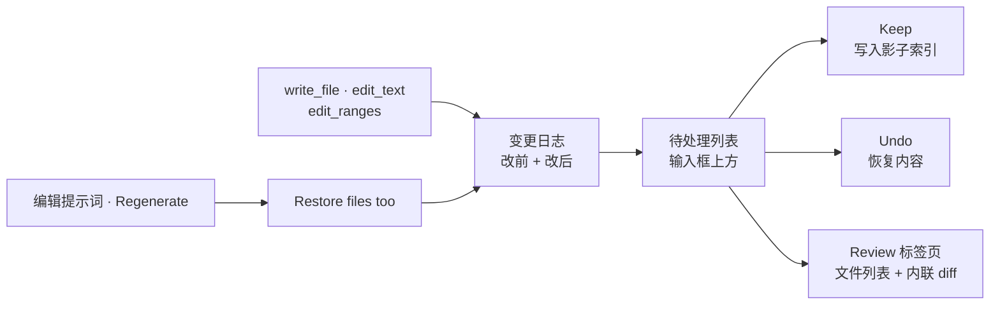

# 检查点与审查

Comonad 在项目之外的影子存储里按文件记录 agent 的每次写入，一条写入一条记录。你自己的 `.git` 永远
不会被触碰。不是每轮都做快照：没有写文件的回合零开销，审查也只看日志点名的文件。

## 待处理变更

输入框上方的列表显示每个文件及其 `+N −M` 行数。**Undo** 和 **Keep** 作用于全部文件；点击一行会在普通
编辑器里打开该文件，并带内联审查。全部审查完后，列表会保留为 **reviewed** 列表，按最近决定排序；
一旦有新的待处理变更，就切回只显示待处理文件。

- **Keep** 接受一个文件或 hunk。
- **Undo** 恢复 agent 写入之前的内容。
- **Review** 打开 **Review Changes** 标签页：左侧是带 `+N −M` 的文件列表，右侧是选中文件的内联
  diff（3 行上下文），每个改动块都有 **Keep** / **Undo**。顶栏作用于全部文件，文件头作用于当前
  文件。点击行号会在旁边打开真实文件并定位到该行。

Review 标签页从日志派生，不保存第二份变更：关闭再打开看到的是同一份待处理状态；在编辑器内联审查里
keep 掉的块会立刻从标签页消失。它审查的是已保存内容：有未保存文本时，该文件的块操作和文件操作都会
禁用，直到你保存；文件被 agent 之外改动过时块操作禁用，**Undo File** 会先询问再恢复。任一待处理
文件未保存时 **Keep All** 会拒绝；**Keep** 接受文件在磁盘上的现状，包括外部编辑。

子 Agent 的文件工具写入记在**主会话**的日志里，而不是它自己的会话。它们与主 Agent 的写入出现在同一个
待处理列表、同一份 diff 和同一组恢复点中。

## 恢复一个回合

用铅笔编辑提示词并重新发送时，如果 agent 在该回合或之后写过文件，会提供 **Restore files too**。
**Regenerate** 会对最后一个回合问同样的问题。两者使用相同的恢复点、脏编辑器和外部修改检查。

因为 fork 与恢复点都在回合边界上，fork 出的聊天永远不会只有工具调用而没有对应的结果。

## 限制

- **`run_shell` 等 shell 命令的改动不会被跟踪。** 这些请用 git 审查。shell 可以改任何文件，而日志只
  知道 agent 自己的写入工具写了什么。`run_shell_test` 在另一个方向上是例外：它只能写 scratch 目录，
  从一开始就不会改动项目文件。
- 旧快照设计留下的影子存储会在日志挂载时删除。它们的会话保留转录，但无法恢复到更早的文件状态。

## 命令

| 命令 | 用途 |
| --- | --- |
| **Comonad: Review Changes** | 打开 Review 标签页，按块、按文件或全部 Keep/Undo |
| `Cmd+Alt+D` / `Ctrl+Alt+D` | 同上 |
| `/review [focus]` | 让 agent 只读审查待处理变更 |

日志是出厂插件树里的一行。关掉 `checkpoints` 会连同服务、审查命令和快捷键一起移除；此后写入就只是
写入，没有撤销故事。

## 下一步

- [上下文](/zh/guide/context) —— 压缩与恢复点
- [安全](/zh/guide/safety) —— agent 能写什么
