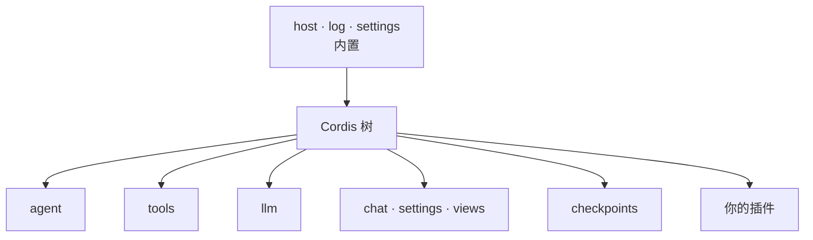

# 扩展

Comonad 的一切都是同一个 [Cordis](https://github.com/cordiverse/cordis) 上下文上的插件：内核、工具、
模型适配器、面板和内容层。插件是 `cordis.yml` 里的一行，它注册的一切都是随行关闭而消失的 effect。



## 行

项目行在 `.comonad/cordis.yml`；用户行在 `~/.comonad/cordis.yml`。

```yaml
# .comonad/cordis.yml
- { id: comonad-plugin-tavern, name: ./plugins/comonad-plugin-tavern/dist/index.js }
- { id: mine, name: ./mine.js, config: { greeting: hello } }
- { id: scratch, name: ./scratch.js, disabled: true }
```

`name` 是路径时按文件读取：`./x`、`../x` 相对于声明它的 `cordis.yml`，`~/x` 从 home 开始，
`/abs/x` 原样使用。其他名字按包解析。

## 写一个插件

```js
// mine.js —— 一个策略和一个工具，都是插件的 effect
export const name = 'mine'
export const inject = ['tools'] // 必须声明，不会自动推断

export function apply(ctx, config) {
  ctx.on('tools/pre-execute', (exec, next) =>
    exec.name === 'run_shell' && /rm -rf/.test(String(exec.arguments?.command ?? ''))
      ? { kind: 'deny', reason: 'not that command' }
      : next(),
  )

  ctx.tools.register({
    name: 'hello',
    description: 'Say hello.',
    capability: 'ro',
    needsNetwork: false,
    needsWorkspace: false,
    parameters: { type: 'object', properties: {}, required: [], additionalProperties: false },
    execute: async () => config.greeting,
  })
}
```

- **读取服务需要 `inject`。** inject 的东西未加载时，行保持 *pending* —— 这就是“功能关掉了”的表达。
  宿主自己的 `ctx.plugins` 是例外，用 `ctx.get('plugins')` 读取。
- **插件注册的一切都随它消失。** 工具、命令、watcher 和面板都随行 dispose。
- **配置就是插件自己的 schema。** 导出 `Config`（schemastery schema），`apply` 前会校验。
- **坏行会被报告，不会拖垮整棵树。** 其余插件照常加载。

## 引用 resolver

插件可以给 `@` 增加一种文件类型，不需要改输入区、消息模型或 wire：

```js
export const inject = ['references']

export function apply(ctx) {
  ctx.effect(() => ctx.references.register({
    id: 'my-format',
    priority: 10,
    mimes: ['application/x-my-format'],
    extensions: ['.myf'],
    claim: ({ head }) => head[0] === 0x25 && head[1] === 0x4d && head[2] === 0x59 && head[3] === 0x46, // "%MYF"
    resolve: async (input) => {
      const bytes = await input.readBytes(input.limits.maxDocumentBytes)
      return [{ kind: 'text', form: 'file', source: { path: input.displayPath }, text: parse(bytes) }]
    },
  }))
}
```

`ctx.references` 负责路径守卫、读取隔离、去重、预算，以及把 part 放到用户消息上的标记。resolver 只负责
识别格式并返回类型化内容；认领后失败会变成错误提示，不会回退成 UTF-8。`comonad-plugin-pdf` 是文档
resolver 的完整示例。

## 安装与管理

**Settings → Plugins → Install…** 按名字提供 Comonad 自带的插件，也接受你自己的文件夹。安装会把文件夹
复制到 `~/.comonad/plugins/<id>`，并往 `cordis.yml` 写一行。**Uninstall** 在确认后删除该行和安装的文件夹。

面板按加载顺序列出每一行、来源、解析目标和状态（`loaded`、`off`，或 `not loaded` 加原因）。
**Disable** / **Enable** 在受信任时写工作区列表，否则写用户列表，并且只重新应用这一行。

**Settings → Inspect → Plugins** 显示依赖树：每个插件提供什么、需要什么、由谁提供，以及关掉它时会
连带停掉什么。

## DeepSeek Harness 插件

`harness` 行重定向 `@deepseek-ai/*` 导入，所以为 [DeepSeek Harness](https://github.com/deepseek-ai/deepseek-harness)
写的插件可以原样加载：

```json
{ "id": "permission-gate", "name": "./permission-gate.mjs" }
```

```ts
import type { Context } from '@deepseek-ai/cordis'

export const name = 'permission-gate'
export const inject = ['tools']

export function apply(ctx: Context) {
  ctx.on('tools/pre-execute', (exec, next) => {
    if (String(exec.arguments?.command ?? '').includes('rm -rf')) {
      return { kind: 'deny', reason: 'Denied by policy.' }
    }
    return next()
  })
}
```

Comonad 实现了 harness 的工具与策略半边：`ctx.tools.register()` 接受两种 spec，`@deepseek-ai/cordis`
就是同一个上下文类，四个瀑布 —— `tools/pre-execute`、`tools/execute`、`tools/post-execute`、
`tools/result` —— 使用 harness 的载荷与决策。harness 的 agent/session 内部未实现；缺失的名字解析为
空模块，并在日志中点名。

## Hooks

Hooks 在生命周期点运行：`SessionStart`、`UserPromptSubmit`、`PreToolUse`、`PostToolUse`、
`PostToolUseFailure`、`Stop`。handler 可以是命令、HTTP、MCP 工具或 prompt。handler 可以返回权限决策
（`deny` / `ask` / `allow`）、附加上下文或修改后的输入。

```json
{
  "PreToolUse": [
    {
      "matcher": "run_shell",
      "hooks": [
        {
          "type": "command",
          "if": "run_shell(rm:*)",
          "command": "echo '{\"hookSpecificOutput\":{\"permissionDecision\":\"deny\",\"permissionDecisionReason\":\"no rm\"}}'"
        }
      ]
    }
  ]
}
```

项目 hooks 在 `.comonad/hooks.json`；用户 hooks 在 `globalStorage/hooks.json`。只在受信任工作区加载，
退出码 2 表示阻断。

## 其他扩展点

| 机制 | 位置 | 说明 |
| --- | --- | --- |
| 指令 | `COMONAD.md`、`AGENTS.md`、`.comonad/instructions.md` | 分层加载；仅受信任工作区 |
| 规则 | `.comonad/rules/*.md` | 进入系统提示 |
| Skills | `.comonad/skills/<name>/SKILL.md` | 提示中列出，按需加载 |
| 子 Agent | `.comonad/agents/*.md` + `comonad.subagents` | frontmatter 选择工具；设置授予写能力 |
| 命令 | `.comonad/commands/*.md` | 自定义 slash 命令 |
| MCP | `comonad.mcpServers` | stdio 或 streamable HTTP；逐服务器能力与覆盖 |
| 记忆 | agent 自己的 `MEMORY.md` | 进入提示，用 `memory` 工具编辑 |

### 子 Agent

子 Agent 是 `.comonad/agents/` 或 `~/.comonad/agents/` 下的 Markdown 文件：

```markdown
---
name: writer
description: 实现一个聚焦的改动。
tools: [read_file, grep_files, write_file, apply_patch, run_shell_test]
maxTurns: 20
---
实现改动。所有项目写入都走文件工具；run_shell_test 只写 scratch 目录。
```

frontmatter **选择**工具；写能力还需要 `comonad.subagents` 中的**授权**（Settings → Subagents）：

```json
{ "comonad.subagents": { "writer": { "files": true, "test": true } } }
```

只读工具不需要授权。`files` 只启用可跟踪的文件工具（`write_file`、`apply_patch`、`apply_edits`）；
`test` 启用 `run_shell_test`。`run_shell`、`start_shell` 和计划写入永远不会授予子 Agent。没有 `tools`
列表的定义视为只读。父模式也必须允许该能力。见[安全](/zh/guide/safety#子-agent)。

`maxTurns`（默认 20）按每回合两图步、最少四步来收紧子 Agent 的图步预算；它只能收紧
`comonad.subagentStepsMode`/`comonad.subagentSteps`，不能放宽。见[设置](/zh/reference/settings#子-agent)。

### MCP

MCP 服务器在 `comonad.mcpServers` 中配置：

```json
{
  "comonad.mcpServers": {
    "filesystem": {
      "command": "npx",
      "args": ["-y", "@modelcontextprotocol/server-filesystem", "/workspace"],
      "capability": "ro"
    }
  }
}
```

每个服务器可设置 `capability`、`writeTools`、`exclude` 和逐工具 `overrides`。工具以 `server__tool`
出现，并经过与内置工具相同的策略门控。服务器是一个子插件：关掉它会关闭连接并移除其工具。

## 下一步

- [参考：工具](/zh/reference/tools) —— 内置工具目录
- [架构](/zh/development) —— 内核接缝与测试宿主
- [安全](/zh/guide/safety) —— 插件工具如何被门控
