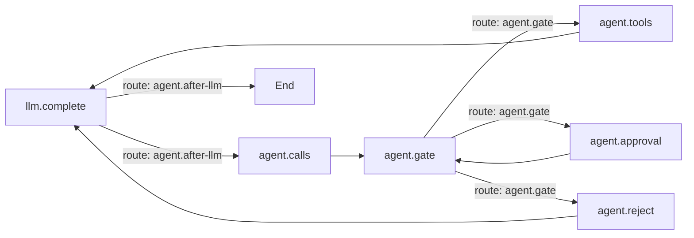

# 图

回合的内层循环是一张编译后的 Mermaid 图：模型调用、策略闸门、审批挂起、工具步骤以及它们之间的
路由。源文件存放在 `comonad.graph` 设置中；空值使用内置的 `agent` 循环。一个源文件可以包含多个
命名图：

`%% graph: id` 命名一个图，`%% default: id` 指定回合默认使用的图，`%% soft node: instruct` 让模型
选择目标。每个回合只运行默认图；其它命名图仍可供插件通过 `ctx.graphs.get(id)` 使用。

## Graph、Policy 与 Executor

- **Graph** 驱动回合。`agent.calls` 开始一个工具批次，`agent.gate` 把策略结果映射成路由；
  `End` 只能从模型节点到达，因此回合总以模型回合收尾。
- **Policy** 是纯决策：对一个批次返回 `allow`、`confirm` 或 `reject`，并为每条调用给出 trace；
  它不认识节点或路由。
- **Executor**（`agent.tools` 与 `ctx.tools.invoke`）在任何工具体运行前核验 GATE 签发的单次
  `ToolAuthorization`。`agent.tools` 只有一个前驱 `agent.gate`；绕过闸门的自定义图会让调用不带
  授权地到达 Executor，从而被拒绝。
- `agent.approval` 挂起回合，恢复后回到 `agent.gate` 重新决策：策略拒绝或用户拒绝优先，审批通过
  则把 `confirm` 解析为 `allow`。

## 配置

在 `settings.json` 中设置 `comonad.graph` 为 Mermaid 源文件。空值使用内置循环；无法解析或编译的
源文件会被记录，并回退到内置循环。`comonad.maxSteps` 限制整个回合的步数（`0` 表示无限制）。
插件通过 `ctx.graphs` 注册 node 实现和 route，因此自定义图可以使用已加载插件提供的任何实现。

## 插件

Graph 是 `cordis.yml` 里的一个 row。关掉 **graph** 会让 agent 失去执行引擎，Plugins 标签页会显示
这条依赖。
