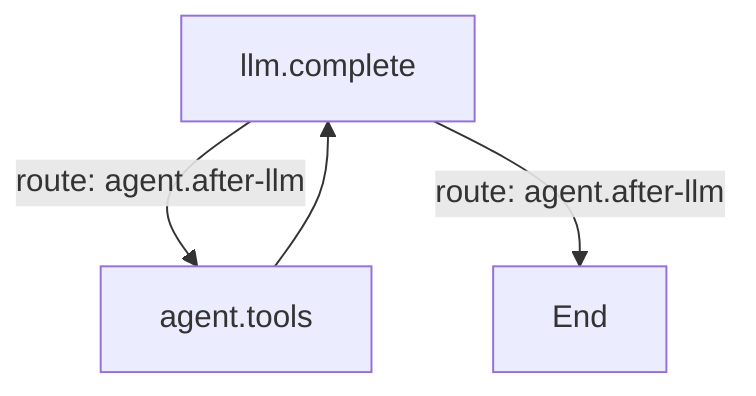

# 图

回合的内层循环是一张编译后的 Mermaid 图：模型调用、工具步骤以及它们之间的路由。**Settings → Graph**
是 Graph 插件的面板。一个源文件可以包含多个命名图：

`%% graph: id` 命名一个图，`%% default: id` 指定回合默认使用的图，`%% soft node: instruct` 让模型
选择目标。每个回合只运行默认图；其它命名图仍可供插件通过 `ctx.graphs.get(id)` 使用。

## 编辑

面板一次编辑一个图：

- 选择器提供 **Set default**、**Duplicate**、**Delete** 和 **+ New**。
- **Whole source** 在同一个缓冲区中编辑整个源文件，而不是选中的图。
- **Validate** 在 **Save** 写入 `comonad.graph` 前检查源文件；**Use shipped default** 清空设置，
  回到内置的 `agent` 图。
- 预览实时渲染选中的图，并列出插件注册的 node 实现和 route。Agent 标签页的 **Max steps** 限制
  整个回合的步数（`0` 表示无限制）。

## 插件

Graph 是 `cordis.yml` 里的一个 row。关掉 **graph** 会让 agent 失去执行引擎，Plugins 标签页会显示
这条依赖。
