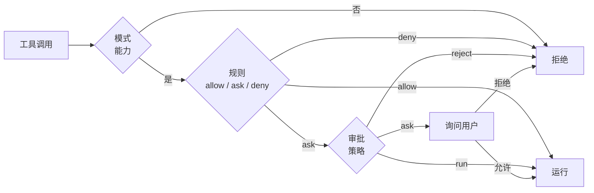

# 安全

三层机制按顺序决定一次工具调用是否运行，拒绝永远优先。



## 1. 模式

模式决定哪些能力存在。

| 模式 | 能力 |
| --- | --- |
| Chat Only（`chat`） | 没有工具；纯对话 |
| Read-Only（`ro`） | 读文件、只读 shell |
| Semi-Write（`sw`） | + 写文件；shell 仍只读 |
| Full Access（`aw`） | + 工作区内完整 shell |
| Plan（`pl`） | 读文件、只读 shell，仅写计划文件 |

模式按聊天记忆；新聊天从 `comonad.mode` 开始。

## 2. 规则

规则是 `comonad.permissions.allow`、`ask`、`deny` 中的模式：

```text
run_shell(npm run test:*)
read_file(./.env)
fetch_url(domain:example.com)
```

在 **Comonad: Open Settings → Rules** 中编辑，一行一条。deny 规则永远优先；allow 规则永远不询问。
没有匹配规则时，由审批策略决定。

## 3. 审批策略

| 策略 | 行为 |
| --- | --- |
| `manual` | 每次调用都询问 |
| `whitelist_accept` | 运行只读默认项和 allow 规则；其余询问 |
| `blacklist_reject` | 拒绝可写默认项和 deny 规则；其余运行 |
| `universal_accept` | 运行模式允许的一切 |
| `universal_reject` | 什么都不运行 |

审批会暂停回合。**Always allow** 会添加一条 allow 规则。**Stop** 会真正取消回合：前台 shell 命令会连同
进程树一起杀掉，待审批会被撤回并拒绝。`start_shell` 启动的后台任务不受影响，仍会继续运行；可在 Tasks
视图或 `stop_shell` 中停止它们。

## 沙箱

shell 命令运行在：

- **macOS：** `sandbox-exec`
- **Linux：** `bwrap`
- **没有 OS 沙箱：** Windows，或未安装工具的宿主机 —— 每次 shell 调用都会请求确认，即使审批策略是 accept

`comonad.allowUnsandboxedShell` 可以跳过这个额外确认。名为 `*_unsandboxed` 的工具始终询问。

### 工作区边界

- `comonad.confineWrite`（默认开启）把写入限制在工作目录内。
- `comonad.confineRead`（默认关闭）对读取做同样限制。
- 两者同时作用于文件工具和 shell 沙箱；符号链接在检查前解析。
- 写受限的 shell 会得到 `<working directory>/.comonad/tmp` 作为临时目录，`TMPDIR` 指向它。
- `.env` 读写都被拒绝；文件工具永远不能写 `.git`。
- 除非关闭 `comonad.filterSensitiveEnv`，密钥、token、密码会从命令环境中移除。

关闭网络时，沙箱内仍可使用回环 TCP/UDP，因此本地测试服务器可用；只有离开本机的流量被阻断。

## 命令超时

前台 shell 调用可带模型选择的 `timeout`（秒），限制在 1–300。`comonad.commandTimeout` 是回退值；
**Always use the command timeout**（`comonad.commandTimeoutOverride`）会用固定值替换模型的选择。
`start_shell` 任务没有超时。

## 危险命令

`rm -rf`、`sudo`、`curl | sh`、`git push --force` 等形态的命令始终会询问，即使策略是 accept。唯一例外
是清理 agent 自己的工作：字面、非递归的 `rm`，且每个目标都在工作区内并且由本会话创建。递归删除、
glob、变量、解析到工作区外的符号链接父目录，以及扫描器无法证明的命令，仍会询问。

## 预设

三层可以组合成预设：**Ask**、**Plan**、**Auto**、**Read only** 和 **Full access**。`comonad.allowFullAccess:
false` 会隐藏 unrestricted 预设；**Full access** 是唯一放弃工作区边界的预设。

## Workspace Trust

在不受信任的工作区中，项目插件、Hooks 和指令文件不会被加载。工具调用仍遵循配置的审批策略和 OS 沙箱。

## 下一步

- [检查点与审查](/zh/guide/checkpoints) —— agent 写过的文件如何处理
- [设置](/zh/reference/settings) —— 所有安全相关设置
- [架构](/zh/development) —— 策略门控与事件接缝
