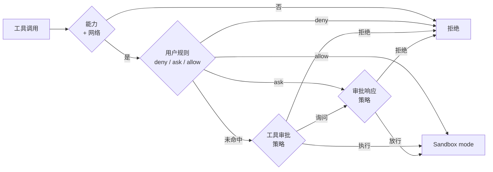

# 安全

六层机制按顺序决定一次工具调用是否运行。第一个阻止调用的层即结束流程；走到最后的调用在配置的沙箱中执行。



| 层 | 设置 | 取值 |
| --- | --- | --- |
| Work mode | `comonad.mode` | `chat`、`ro`、`sw`、`aw`、`pl` |
| Network access policy | `comonad.network` | `on`、`off` |
| User rule | `comonad.permissions` | `deny`、`ask`、`allow` 三个列表 |
| Tool approval policy | `comonad.approval` | `manual`、`whitelist_accept`、`blacklist_reject`、`universal_accept`、`universal_reject` |
| Approval response policy | `comonad.approvalResponse` | `ask`、`never` |
| Sandbox mode | `comonad.sandboxMode` | `workspace-read`、`read-only`、`workspace-write`、`danger-full-access` |

## 1. Work mode

模式决定哪些能力存在。

| 模式 | 能力 |
| --- | --- |
| Chat Only（`chat`） | 没有工具；纯对话 |
| Read-Only（`ro`） | 读文件、只读 shell |
| Semi-Write（`sw`） | + 写文件，+ 测试 shell（工作区只读、仅 scratch 可写） |
| Full Access（`aw`） | + 工作区内完整 shell |
| Plan（`pl`） | 读文件、只读 shell，仅写计划文件 |

模式按聊天记忆；新聊天从 `comonad.mode` 开始。

## 2. Network access policy

`on` 允许声明了网络需求的工具运行，也允许沙箱内的命令访问网络。`off` 同时拒绝两者；OS 沙箱内仍保留回环，
本地测试服务器和 IPC 客户端因此仍可用。

## 3. User rule

规则是 `comonad.permissions.allow`、`ask`、`deny` 中的模式：

```text
run_shell(npm run test:*)
read_file(./.env)
fetch_url(domain:example.com)
```

在 **Comonad: Open Settings → Policies → User rules** 中编辑，一行一条。三个列表按以下顺序检查：

1. **deny** —— 拒绝该调用；
2. **ask** —— 询问；
3. **allow** —— 执行。

规则一旦命中就决定结果；只有三个列表都未命中时，Tool approval policy 才会介入。因此 allow 规则在
`universal_reject` 下也会执行。

## 4. Tool approval policy

| 策略 | 直接执行 | 先询问 | 拒绝 |
| --- | --- | --- | --- |
| `manual` | – | 全部调用 | – |
| `whitelist_accept` | `ro`、`shell_ro`、`rw_plan` | 其余调用 | – |
| `blacklist_reject` | 其余调用 | 危险命令 | `rw`、`shell_test`、`shell_rw`、`rw_plan` |
| `universal_accept` | 全部调用 | 危险命令 | – |
| `universal_reject` | – | – | 全部调用 |

白名单和黑名单是固定的能力集合；用用户规则来指定单个工具或参数。

## 5. Approval response policy

- `ask`：把每条确认交给应答方 —— 聊天面板、聊天参与者或兜底对话框。应答方只回答自己聊天的请求。没有
  应答方时请求按拒绝处理，绝不默认放行。
- `never`：所有确认直接拒绝，不显示。

审批会暂停回合。**Always allow** 会添加一条 allow 规则。**Stop** 会真正取消回合：前台 shell 命令会连同
进程树一起杀掉，待审批会被撤回并拒绝。`start_shell` 启动的后台任务不受影响，仍会继续运行；可在 Tasks
视图或 `stop_shell` 中停止它们。

## 6. Sandbox mode

Sandbox mode 是每个获准调用实际运行的读写范围。执行器在每次调用时解析它，由文件工具和 OS 沙箱
（macOS 的 `sandbox-exec`、Linux 的 `bwrap`）强制执行。

| 模式 | 读取 | 写入 |
| --- | --- | --- |
| `workspace-read` | 工作区 + 系统运行时 | 无 |
| `read-only` | 任意位置 | 无 |
| `workspace-write` | 任意位置 | 仅工作区 |
| `danger-full-access` | 任意位置 | 任意位置 |

调用可以收窄模式，但不能放宽：只读 shell 不写任何东西，测试 shell 只写自己的 scratch 目录，`run_task`
运行的是编辑器自己的进程，因此只在 `danger-full-access` 下可用。

### 没有 OS 沙箱

在 Windows，或没有 `sandbox-exec`/`bwrap` 的宿主机上，可写 shell 只能在 `danger-full-access` 且
Network access policy 为 **on** 时运行；其它组合一律拒绝，因为文件与网络限制都无法强制执行。只读
shell 和测试 shell 始终需要 OS 沙箱，因为它们的承诺无法在没有沙箱时兑现。聊天底部和 `/status` 会显示
宿主机没有 OS 沙箱。

### 工作区边界细节

- `workspace-write` 的 shell 会得到 `<working directory>/.comonad/tmp` 作为临时目录，`TMPDIR` 指向它。
- 测试 shell 使用自己的目录 `<working directory>/.comonad/scratch/<session>`，暴露为
  `$COMONAD_SCRATCH`；`TMPDIR`、`TMP`、`TEMP`、`HOME`、`XDG_CACHE_HOME` 和 `PYTHONPYCACHEPREFIX`
  都指向其中。工作区的其余部分保持只读。
- `.env` 读写都被拒绝；文件工具永远不能写 `.git`。
- 符号链接在包含检查前解析。
- 除非关闭 `comonad.filterSensitiveEnv`，密钥、token、密码会从命令环境中移除。

## 子 Agent

子 Agent 运行同样的六层，但使用**自己的有效策略**。委派开始时构建，只能收紧父级：

| 策略 | 子级得到的策略 |
| --- | --- |
| Work mode | 父级有效能力集合 ∩ 委派能力过滤 ∩ 硬上限（`ro`、`shell_ro`、`rw`、`shell_test`） |
| Network | 父级开关；委派可以关闭，不能打开 |
| User rule | 全部祖先规则；`deny` > `ask` > `allow` |
| Tool approval | 委派单独指定的策略，默认 `whitelist_accept` |
| Approval response | 固定 `never` |
| Sandbox | 父级沙箱与委派上限中更严格者 |

Spawn 与 Fork 共用完全相同的策略，只在上下文上不同。完整快照、策略 revision、父会话和创建时间保存在
子会话中。运行中的子级在下一次模型请求和下一次 gate 前重新收紧；父级事后放宽不会放宽子级。冷恢复读取
保存的快照。

由此：

- 父级为 `ro` 时，子级写入被拒绝。
- 父级关闭网络时，子级保持关闭。
- 祖先 `deny` 胜过子级 `allow`（规则在审批策略之前执行）。
- 祖先 `ask` 产生确认，而子级固定的 `never` 应答直接拒绝。
- 子级审批策略要求询问时，调用直接拒绝，不显示审批卡。
- 父级收紧只作用于后续调用；已经启动的进程保持启动时的沙箱。

授权、定义和硬上限仍然决定工具范围：

- `files` 只授予可跟踪的文件工具（`write_file`、`apply_patch`、`apply_edits`）。
- `test` 授予 `run_shell_test`。
- 只读工具始终可用。
- 没有 `tools` 列表的定义是只读的。
- 内置 `implement` 默认是 **files + test**；其它内置 Agent 和所有自定义 Agent 在授权前都是只读。
- 项目文件覆盖内置名称时，不会继承该内置 Agent 的默认授权。
- 子 Agent 的文件写入记在**父聊天**的 journal 下，因此出现在它的 review、inline diff 和 Git Changes 中。
- 可写子 Agent 在前台运行，一次一个。后台子 Agent 是只读的。

子级默认审批是 `whitelist_accept`，应答固定 `never`，所以委派的写入会先询问再被拒绝。要让可写 Agent
工作，请在 `agent` 调用上传 `approval: "universal_accept"`，或添加继承的 allow 规则。委派还接受
`capabilities`、`network`、`sandboxMode` 和 `approval` 来收窄子级。

`agent` 调用本身也是普通工具，受父级策略约束。在 accept 策略下它可能无卡启动子级；如果希望在委派
执行前审查子级审批策略，请为 `agent` 添加 `ask` 或 `deny` 规则。

## 命令超时

前台 shell 调用可带模型选择的 `timeout`（秒），限制在 1–300。`comonad.commandTimeout` 是回退值；
**Always use the command timeout**（`comonad.commandTimeoutOverride`）会用固定值覆盖模型的选择。
`start_shell` 任务没有超时。

## 危险命令

`sudo`、`curl | sh`、`git push --force` 等形态在策略本来会直接执行时仍然询问（`universal_accept`，或
`blacklist_reject` 下的非黑名单能力）。`manual` 本来就会询问所有调用。`whitelist_accept` 下，白名单能力
中的危险形态会直接执行 —— 白名单信任的正是 OS 强制的只读范围；要阻止特定形态，请写 `deny` 或 `ask`
规则。用户 allow 规则即视为同意。`rm` 是例外：删除自己的工作永远不问，递归与否都一样。

当目标是本会话写过的文件、本会话创建的目录下的路径（整个子树），或只有本会话可写的树 —— 测试 shell 的
scratch 和工作区 `.comonad/tmp` —— 时，目标才算本会话所有。`*`/`?` glob 只要求固定前缀是自有目录。
扫描器无法归入自有根的一切仍会询问。

## 预设

这些层可组合为预设：**Ask**、**Plan**、**Auto**、**Read only** 和 **Full access**。预设位于模式和审批
控件中。`comonad.allowFullAccess: false` 会隐藏 unrestricted 预设。

| 预设 | Work mode | Tool approval | Network | Sandbox mode |
| --- | --- | --- | --- | --- |
| Ask | `sw` | `manual` | off | `workspace-write` |
| Plan | `pl` | `whitelist_accept` | off | `workspace-write` |
| Auto | `aw` | `universal_accept` | off | `workspace-write` |
| Read only | `ro` | `whitelist_accept` | off | `read-only` |
| Full access | `aw` | `universal_accept` | on | `danger-full-access` |

## 决策轨迹

每个进入管线的调用都会留下决策轨迹：实际到达的每层一个节点，被拒绝或进入 dispatch 时写一个终态
事件。`/audit <call_id>` 从终态回溯到根节点，并给出策略 revision 和快照。详见[决策轨迹](/zh/guide/audit)。

## 工作区信任

项目插件、hooks 和指令文件在不受信任的工作区中不会被加载。工具调用仍遵循配置的审批策略和 OS 沙箱。

## 下一步

- [检查点与 review](/zh/guide/checkpoints) —— Agent 写入的文件会怎样
- [设置](/zh/reference/settings) —— 所有安全相关设置
- [架构](/zh/development) —— 策略门与事件接缝
