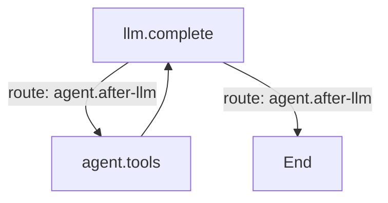

# 工作流

工作流是任务的"外层形状"：一串阶段，每个阶段有自己的目标、工具、审批门和完成证据。内层仍然是模型与
工具调用的图循环；工作流决定下一阶段是什么、什么时候必须由你批准、以及什么才算验证通过。

Comonad 内置一个最佳实践工作流 **Standard coding task**：

| 阶段 | 运行什么 | 产物 |
| --- | --- | --- |
| **Research** | 只读模式的 agent 阶段 | 相关文件、调用路径、测试与约束的笔记 |
| **Plan** | plan 模式的 agent 阶段 | 具体计划；运行暂停等待批准 |
| **Implement** | 会话当前模式的 agent 阶段 | 聚焦的修改，全部进入变更日志 |
| **Verify** | checks 阶段，不调用模型 | 编辑器新错误 + 你配置的命令 |
| **Review** | 只读模式的 agent 阶段 | 最终报告：改了什么、验证结果、遗留问题 |

计划门是真正的暂停。**Approve** 进入实现；**Deny** 停止工作流并保留计划。窗口重载后仍可用
`/resume` 再次询问。

## 什么时候运行

默认可写模式（`sw`/`aw`）下的编码任务自动运行。纯问答、`/plan`、`/review`、子代理和静默生成保持
直接运行。用 `/workflow <任务>` 强制本回合使用默认工作流，或用 `/workflow <id> <任务>` 指定另一个。
**When** 为 `Manual` 的工作流永远不会自动运行。

触发方式、默认工作流和整个工作流库都在 **Settings → Workflow**。

## 验证是证据，不是声明

checks 阶段从不调用模型。它报告：

- **编辑器诊断**：只算本次运行开始后新出现的、且落在本回合写入文件里的错误；之前就存在的错误不算。
- **命令**：你在阶段里配置的命令，按顺序在会话的 sandbox、网络策略、禁读路径和超时下运行。命令来自
  workspace settings，因此只在受信工作区运行。

失败且还有修复额度时，运行带着检查输出回到修复阶段（内置预置回到 **Implement**）。模型修复后 checks
再跑一次。额度用完，工作流标记为 **Failed**，review 阶段会被要求明确说明失败。

## 自定义

**Settings → Workflow** 是可视化编辑器：

- 左侧是工作流库；复制内置预置即可做变体。
- 阶段分为 **Agent**（选择图、模式、目标、可选审批门）和 **Checks**（诊断、命令、超时、修复次数和
  失败回到哪个阶段）。
- 拖拽排序；可新增、复制、删除阶段。
- **Detect from package.json** 会在存在对应 scripts 时建议 `npm test`、`npm run typecheck`、
  `npm run lint`、`npm run build`。
- **JSON** 模式可批量编辑整个工作流库。

阶段的 mode 只能收紧会话能力：plan 阶段只增加 plan 文件写入，绝不增加项目写入。只读阶段会自动放行
只读工具调用（研究时不必每个文件都问你）；项目写入始终使用会话的 approval 策略。

## 图

**Settings → Graph** 是 Graph 插件的面板。一个源文件可以包含多个命名图：

`%% graph: id` 命名一个图，`%% default: id` 指定回合默认使用的图，`%% soft node: instruct` 让模型
选择目标。面板一次编辑一个图，实时渲染，并列出插件注册的 node 实现和 route。工作流的每个 agent 阶段
按 id 选择其中一个图。

## 插件

Graph 和 Workflow 是 `cordis.yml` 里两个独立的 row。关掉 **workflow** 会移除 Workflow tab 和
`/workflow`，普通回合仍走图循环；关掉 **graph** 会让 agent 失去执行引擎，Plugins tab 会显示这条依赖。
