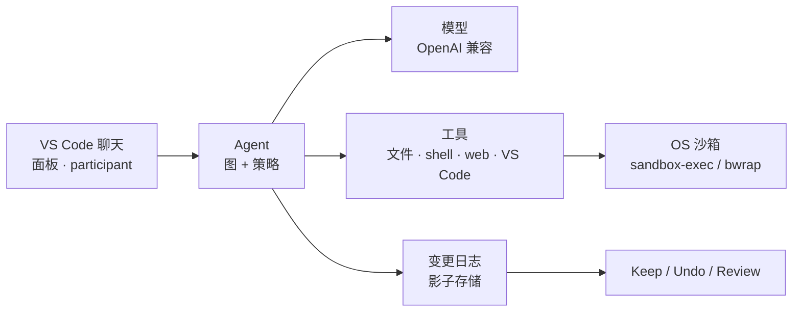

# Comonad Agent for VS Code

本地优先、可审计的 VS Code coding agent。它用你选择的模型 —— 默认 DeepSeek，或任意 OpenAI 兼容端点 ——
运行图编排的工具循环，记录它写过的每个文件，并在任何内容离开沙箱前询问你。



## 为什么是 Comonad

- **本地优先。** API key 存在 VS Code `SecretStorage`；会话、检查点与日志留在运行 agent 的机器（或远程主机）上。
- **天然可审计。** 每一轮都是一次带类型事件、能力门控和审计日志的图运行。文件写入按文件记录，不会被静默覆盖。
- **可扩展。** 内核、工具、模型适配器和 UI 都是同一个 [Cordis](https://github.com/cordiverse/cordis)
  上下文上的插件。关掉一行、单独配置，或挂载你自己的插件。

## 安装

**从打包好的 VSIX 安装**

```sh
npm run package
code --install-extension comonad-0.2.0.vsix
```

**从源码运行**

```sh
npm install
npm run compile
```

在 VS Code 中按 `F5` 启动 Extension Development Host。

然后配置模型 key —— 默认的 DeepSeek Flash profile 只需要 `DEEPSEEK_API_KEY` —— 或用
**Comonad: Configure Model Provider** 添加任意 OpenAI 兼容端点。用 **Comonad: Open Chat**
（`Cmd+Alt+C` / `Ctrl+Alt+C`）打开聊天。

## 五分钟上手

1. 从右侧 Secondary Side Bar 打开聊天。
2. 提一个问题，或描述你想做的改动。
3. 审批提示会内联出现：**Allow once**、**Always allow** 或 **Deny**。
4. shell 与文件改动会显示成工具卡；点击卡片展开命令和输出。
5. 在输入框上方审查待处理文件：**Keep**、**Undo** 或 **Review**。

## 文档

| 开始 | 内容 |
| --- | --- |
| [聊天](/zh/guide/chat) | 会话、输入区、转录、工具卡、`@` 引用 |
| [安全](/zh/guide/safety) | 模式、审批策略、规则、沙箱、密钥 |
| [上下文](/zh/guide/context) | 窗口预算、压缩、`/context` |
| [检查点与审查](/zh/guide/checkpoints) | 变更日志、Keep/Undo、恢复点 |
| [内容层](/zh/guide/content) | 角色、世界书、人格、预设（SillyTavern 格式） |
| [扩展](/zh/guide/extend) | 插件、Hooks、Skills、Subagents、MCP |
| [远程与容器](/zh/guide/remote) | Remote SSH、WSL、Dev Containers |
| [命令](/zh/reference/commands) | 内置与自定义 slash 命令 |
| [工具](/zh/reference/tools) | 工具目录与 MCP |
| [设置](/zh/reference/settings) | 你最可能修改的设置 |
| [架构与开发](/zh/development) | 内核接缝、构建与测试 |

Also available in [English](/).

## 许可证

Comonad Agent for VS Code 使用 **AGPL-3.0-only** 许可证。见
[LICENSE](https://github.com/zeroDtree/comonad-vscode-extension/blob/main/LICENSE)。第三方组件列在
[THIRD_PARTY_NOTICES.md](https://github.com/zeroDtree/comonad-vscode-extension/blob/main/THIRD_PARTY_NOTICES.md)。
